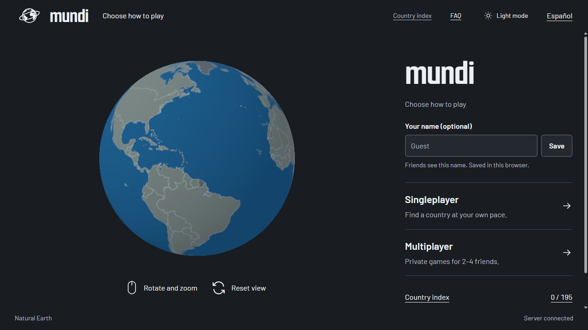

# Mundi

**An online multiplayer geography guessing game for 2 to 4 friends.** Find the mystery country on an interactive globe: race against each other or take turns using shared clues. You can also play solo and collect your discoveries.

**[Play at mundi.top](https://mundi.top)** · English and Spanish · Desktop and mobile



## Play with friends

Create a private room, share the invitation link and get ready. Play together online from different devices. You do not need to be on the same network.

- **Race:** guess independently and compete to find the country first.
- **Take turns:** alternate guesses, share distance clues and try to land the winning answer.
- **Singleplayer:** explore at your own pace with unlimited guesses and no round timer.

Enter a country name and select a suggestion. Colors and approximate distances guide your next guess. The in-game FAQ explains the rules, territories and distance calculations.

## Your country index

Correct guesses join your collection of 195 countries, which you can explore on a globe or flat map. Your progress and optional display name are saved in this browser. No account is required; clearing site data removes your progress, and it does not sync between devices.

The live site uses Cloudflare Web Analytics for aggregate traffic and performance statistics.

## Built with

- **Languages:** TypeScript, HTML and CSS.
- **Frontend:** Vite and Three.js for the interactive globe.
- **Backend:** Node.js and Fastify, with WebSockets for real-time multiplayer.
- **Storage:** browser local storage for progress and server memory for rooms. No database required.
- **Hosting:** Render.

## Run locally

Requires **Node.js 24 LTS** (24.18.1 or newer within version 24) and npm.

```sh
git clone https://github.com/faacuaramburu/mundi.git
cd mundi
npm ci
npm run dev:server
```

In a second terminal:

```sh
npm run dev
```

Open **[http://127.0.0.1:5173](http://127.0.0.1:5173)**. Stop both processes with `Ctrl+C`.

## Credits and license

- Map data: [Natural Earth](https://www.naturalearthdata.com/), public domain.
- Flags: [flag-icons](https://github.com/lipis/flag-icons), MIT.
- Fonts: Barlow and Smooch Sans, SIL Open Font License.
- Code: [MIT](LICENSE).
