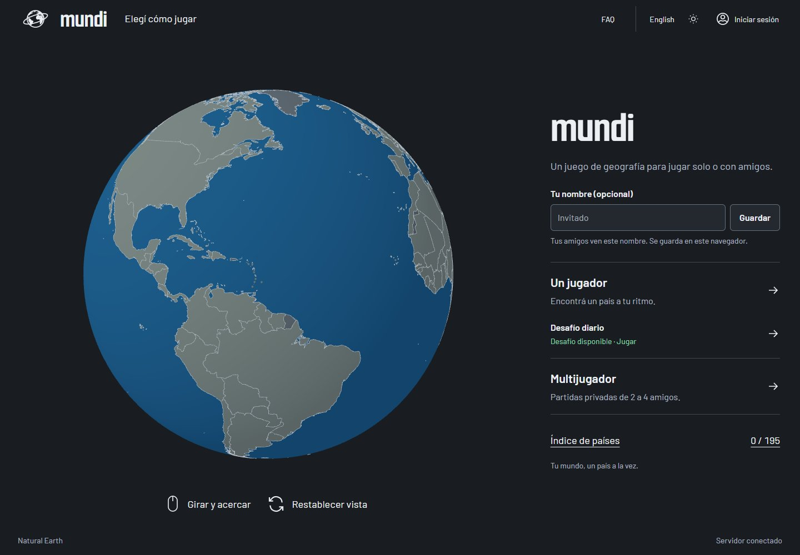

# Mundi

**A geography guessing game to play solo or with 2 to 4 friends.** Find the mystery country on an interactive globe, solve the daily challenge, or race against friends using distance clues. Collect the countries you discover as you play.

**[Play at mundi.top](https://mundi.top)** · English and Spanish · Desktop and mobile



## Play with friends

Create a private room, share the invitation link and get ready. Play together online from different devices. You do not need to be on the same network.

- **Race:** guess independently and compete to find the country first.
- **Take turns:** alternate guesses, share distance clues and try to land the winning answer.
- **Singleplayer:** explore at your own pace with unlimited guesses and no round timer.
- **Daily challenge:** the same mystery country for everyone, renewed at 00:00 UTC. Resume your attempts, track your daily streak, share the result and keep playing in singleplayer after finishing.

Enter a country name and select a suggestion. Colors and approximate distances guide your next guess. The in-game FAQ explains the rules, territories and distance calculations.

## Your country index

Correct guesses join your collection of 195 countries, which you can explore on a globe or flat map. Filter by continent, discovery status and date. The home globe highlights the countries you have found and rotates slowly. Open the index from the home screen.

## Optional Google accounts

Play without an account and keep your discoveries, daily attempts and optional guest name in this browser. Clearing site data removes guest progress.

Sign in with Google to merge existing guest progress into your account and synchronize discoveries and daily challenges across devices. Each account has its own local cache; switching accounts keeps their progress separate.

Choose a unique username with 3–24 characters and at least three letters. Names start with a letter, allow a–z, numbers and underscores, and are saved in lowercase. The profile icon opens your account; this is the single place to edit a signed-in username. Guest display names remain optional on the home and multiplayer screens.

Firebase project owners can see accounts in Authentication and usernames in Firestore under `players/{uid}`. See [Firebase setup and data model](docs/FIREBASE.md) for configuration and access rules.

The live site uses Cloudflare Web Analytics for aggregate traffic and performance statistics.

## Built with

- **Languages:** TypeScript, HTML and CSS.
- **Frontend:** Vite and Three.js for the interactive globe.
- **Backend:** Node.js and Fastify, with WebSockets for real-time multiplayer.
- **Storage:** browser local storage for guest progress and account caches, optional Firebase Authentication and Cloud Firestore for account sync, and server memory for rooms.
- **Hosting:** Render.

## Run locally

Requires **Node.js 24 LTS** (24.18.1 or newer within version 24) and npm.

```sh
git clone https://github.com/faacuaramburu/mundi.git
cd mundi
npm ci
npm run dev:server
```

In a second terminal:

```sh
npm run dev
```

Open **[http://127.0.0.1:5173](http://127.0.0.1:5173)**. Stop both processes with `Ctrl+C`.

Accounts stay hidden until `FIREBASE_WEB_CONFIG` is configured. Local guest games do not require a Firebase project. See [.env.example](.env.example) and [Firebase setup](docs/FIREBASE.md).

```sh
npm test
npm run lint
npm run build
npm run check:client-build
```

The [visual conventions](DESIGN.md) document shared typography, navigation, controls and responsive behavior.

## Credits and license

- Map data: [Natural Earth](https://www.naturalearthdata.com/), public domain.
- Flags: [flag-icons](https://github.com/lipis/flag-icons), MIT.
- Fonts: Barlow and Smooch Sans, SIL Open Font License.
- Code: [MIT](LICENSE).
